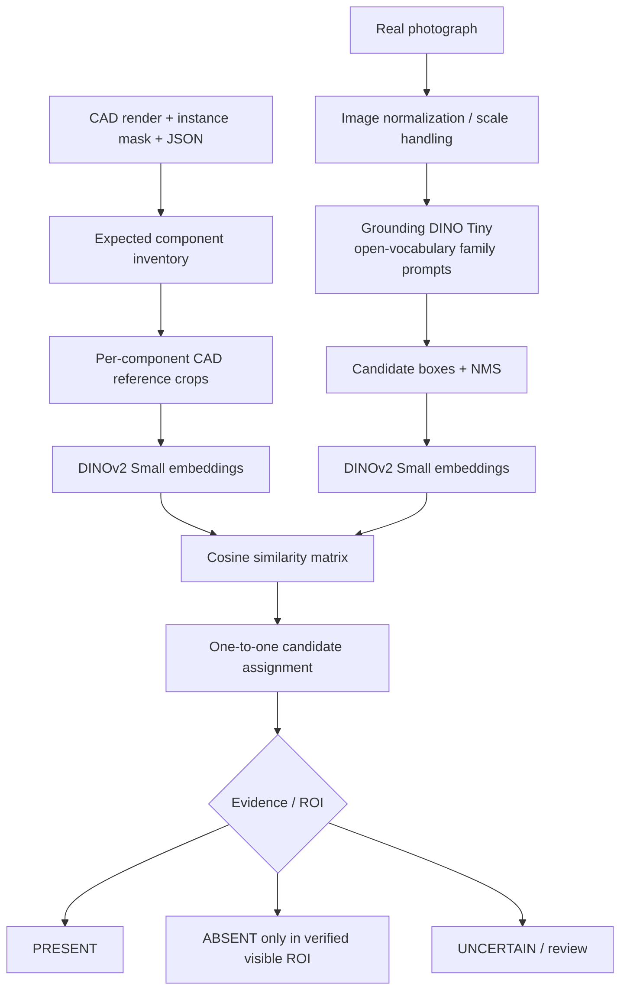

# Architecture — Option A pretrained-only

## Model roles
- Grounding DINO Tiny: proposes object boxes from text prompts for broad component families (bolt, washer, nut, cover, box).
- DINOv2 Small: extracts frozen visual embeddings from CAD reference crops and real candidate crops.
- No model is trained or fine-tuned. No SAM2 or few-shot training is part of Option A.

## Matching
A family detector is run once per image. Candidate embeddings are cached. A one-to-one greedy assignment associates each detected candidate with at most one expected component instance, preventing a single detected bolt from satisfying every expected bolt. The combined score is a ranking score, not a probability.

## Decision policy
- PRESENT: an assigned candidate has a CAD-reference embedding match above the configured threshold.
- ABSENT: only if a human/validated registration supplies a real-image ROI and confirms it is visible, and no family candidate is found in that ROI.
- UNCERTAIN: all other cases, including no detection without a verified expected ROI.

## Known limitations
The detector's language vocabulary may not recognize small industrial fasteners. DINOv2 similarity between a CAD render and a real photo can be affected by viewpoint, material, lighting and synthetic-to-real differences. The supplied mask coordinates are CAD-render coordinates and are not automatically real-photo coordinates. Calibration/registration is needed before interpreting a part's location in the photograph.

## Problem Statement 2 extension
Use camera intrinsics and pose estimation to register CAD to the camera. Prefer depth/stereo/structured light for 3D measurement. Estimate each component's translation, rotation and dimensions; compare against CAD nominal values and GD&T tolerances. A single uncalibrated 2D image cannot guarantee true 3D dimensions.
