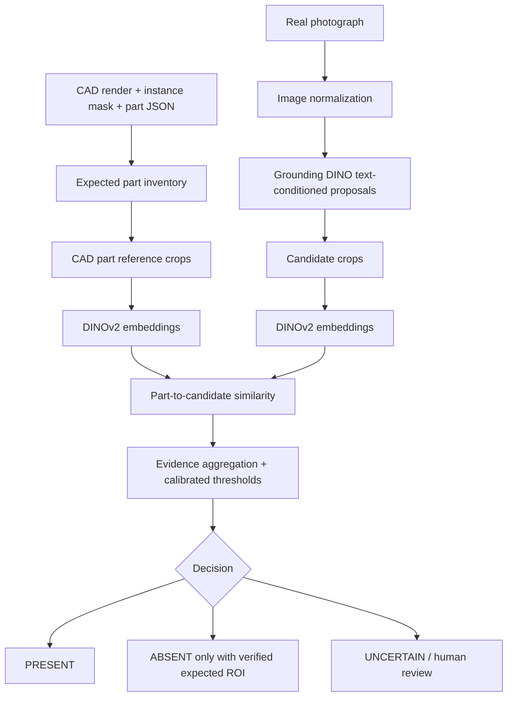

# System architecture

## Why a hybrid system?
- Grounding DINO supplies open-vocabulary localization proposals.
- DINOv2 supplies appearance descriptors for reference-to-candidate comparison.
- CAD masks and part mapping provide the expected inventory.

## Correct absence logic
A text detector failing to find a component is not proof of absence. To make a defensible absence decision, first establish the expected image region through camera calibration / CAD-to-image registration, check that the region is visible and not occluded, and then apply a validated local classifier. If registration or visibility is uncertain, return `UNCERTAIN`.

## Problem Statement 2 extension
For positional/dimensional checks:
1. Calibrate camera intrinsics and camera-to-object pose.
2. Register CAD coordinates to the observed scene.
3. Prefer stereo, structured light, or depth sensing for 3D dimensions.
4. Estimate each component pose and dimensions.
5. Compare translation, rotation, dimensions, and surface deviation against CAD tolerances/GD&T.
6. Report pass/fail with uncertainty and measurement traceability.
